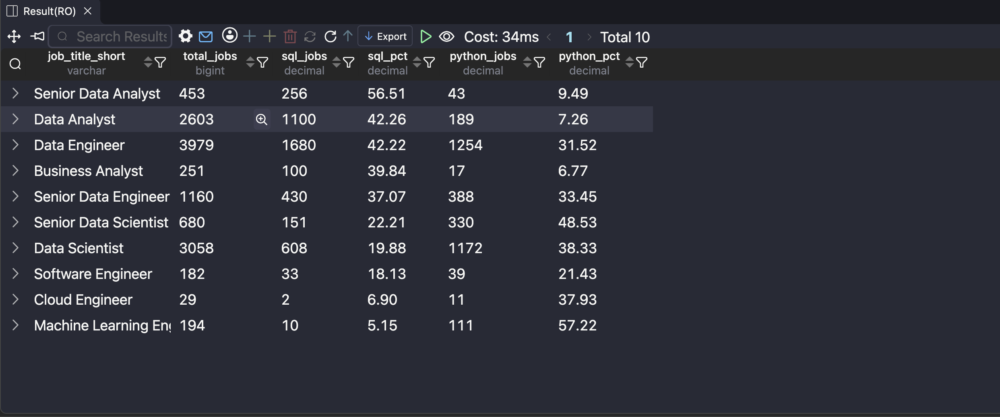
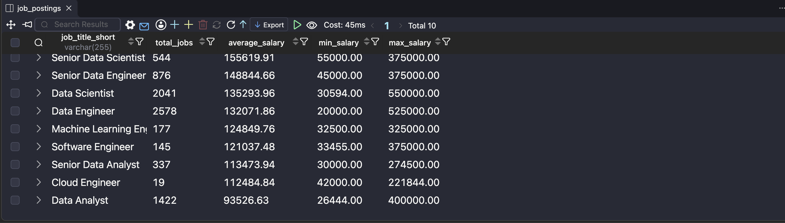
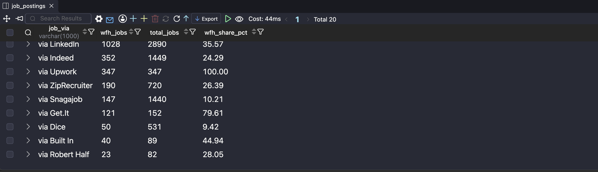
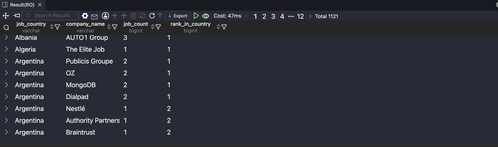

# 🗄️ Data Jobs Market, Salary & Skill Demand Analysis (MySQL)

## 📌 Project Overview
This project analyzes **12,589 data-related job postings** stored in a MySQL relational database (`job_market_db.job_postings`) to uncover market trends across compensation, remote work adoption, recruitment platforms, weekly hiring schedules, and core technical skill demand (**SQL** and **Python**).

Built as part of my **Data Analyst Portfolio**, this repository showcases practical SQL workflows including raw string cleaning, data type casting, conditional segmentation, modular CTE pipelines, and analytical ranking using Window Functions.

---

## 🛠️ Tech Stack & SQL Techniques
* **Database & Tools:** MySQL 8.0, Visual Studio Code (Database Client), DBeaver
* **Data Cleaning & Type Casting:** `TRIM()`, `LOWER()`, `REPLACE()`, `CAST(... AS DECIMAL(10, 2))`, `COALESCE()`, `STR_TO_DATE()`, `DAYNAME()`, `DAYOFWEEK()`
* **Aggregation & Business Logic:** `GROUP BY`, `HAVING`, `COUNT()`, `AVG()`, `MIN()`, `MAX()`, `SUM()`, `ROUND()`, `CASE WHEN`
* **Advanced Querying:** Common Table Expressions (`WITH` / CTEs) and Window Functions (`SUM(COUNT(*)) OVER ()`, `DENSE_RANK() OVER (PARTITION BY ... ORDER BY ...)`)

---

## 🔍 Analytical Questions & Query Breakdown

The SQL script (`job_market_analysis.sql`) answers **7 core business questions** structured from initial data inspection and cleaning to advanced ranking and skill demand analysis:

1. **Dataset Exploration (`SELECT ... LIMIT 10`)**
   * Inspected sample records from `job_market_db.job_postings` to verify schema structure, formatting anomalies, and missing values.
2. **Hourly Compensation Standardization by Country**
   * Cleaned string-formatted hourly rates (`salary_hour_avg` containing `$` signs, whitespace, comma decimals like `$39,80`, and text `'(null)'`), cast them into `DECIMAL(10, 2)`, and calculated average hourly rates and posting counts per `job_country`.
3. **Annual Salary Benchmarks Across Job Titles**
   * Computed total postings alongside average, minimum, and maximum annual salaries (`salary_year_avg`) across `job_title_short` categories to identify top-paying roles.
4. **Market Salary Tier Segmentation**
   * Categorized valid annual salary postings into three compensation brackets (`Under $70k`, `$70k - $120k`, `Above $120k`) using `CASE WHEN` and calculated each tier's market share percentage using `SUM(COUNT(*)) OVER ()`.
5. **Remote Work (WFH) Volume & Share by Recruitment Channel**
   * Evaluated hiring platforms (`job_via`) with at least 10 remote listings (`job_work_from_home = 1`) via `HAVING`, comparing total WFH jobs against overall platform volume to measure remote work concentration (`wfh_share_pct`).
6. **Top 10 Hiring Companies per Country**
   * Combined a CTE (`company_country_counts`) with `DENSE_RANK() OVER (PARTITION BY job_country ORDER BY COUNT(*) DESC)` to rank the Top 10 most active employers within each country.
7. **Weekly Job Posting Trends**
   * Parsed text timestamps (`job_posted_date` formatted as `%d/%m/%y %H:%i`) into `DATETIME` values using `STR_TO_DATE()` and aggregated posting frequency by day of the week (`DAYNAME()`, `DAYOFWEEK()`).
8. **SQL & Python Skill Demand by Role**
   * Built a CTE (`skill_demand`) using `COALESCE()`, `LOWER()`, and `LIKE` pattern matching on `job_skills` to quantify the exact count and percentage share of postings requiring **SQL** and **Python** per job role.

---

## 📊 Key Results & Query Outputs

### 1. SQL & Python Skill Demand by Role

| Role (`job_title_short`) | Total Jobs | SQL Jobs | SQL Share (%) | Python Jobs | Python Share (%) |
| :--- | :---: | :---: | :---: | :---: | :---: |
| **Senior Data Analyst** | 453 | 256 | 56.51% | 43 | 9.49% |
| **Data Analyst** | 2,603 | 1,100 | 42.26% | 189 | 7.26% |
| **Data Engineer** | 3,979 | 1,680 | 42.22% | 1,254 | 31.52% |
| **Business Analyst** | 251 | 100 | 39.84% | 17 | 6.77% |
| **Senior Data Engineer** | 1,160 | 430 | 37.07% | 388 | 33.45% |
| **Senior Data Scientist** | 680 | 151 | 22.21% | 330 | 48.53% |
| **Data Scientist** | 3,058 | 608 | 19.88% | 1,172 | 38.33% |
| **Software Engineer** | 182 | 33 | 18.13% | 39 | 21.43% |
| **Cloud Engineer** | 29 | 2 | 6.90% | 11 | 37.93% |

### 2. Salary Benchmarks & Market Tier Distribution

### 3. Remote Work (WFH) Share by Recruitment Channel

### 4. Employer Ranking & Weekly Posting Trends

### 💡 Key Takeaways
* **SQL is the core requirement for Analyst roles:** Over **42%** of Data Analyst postings and **56.5%** of Senior Data Analyst postings explicitly require SQL, making it the #1 foundational query skill.
* **Python dominates Data Science & Engineering:** Data Scientist (`38.33%`), Senior Data Scientist (`48.53%`), and Data Engineer (`31.52%`) roles show significantly higher Python demand compared to traditional analyst positions.

---
